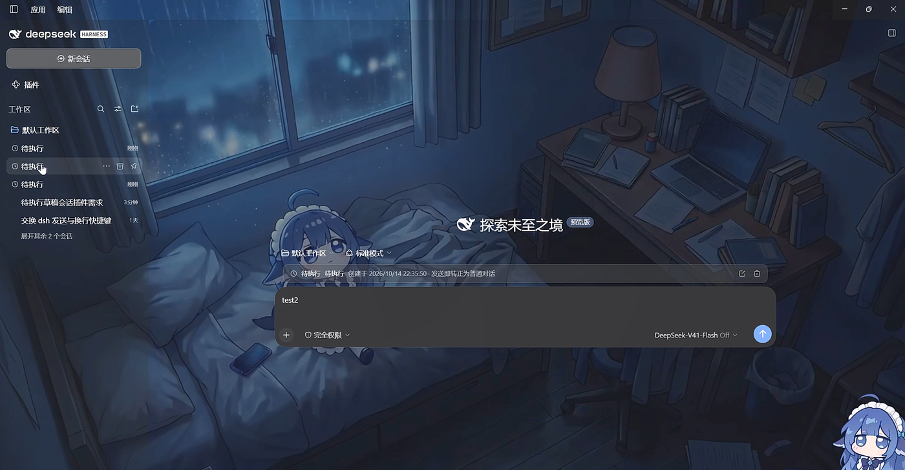
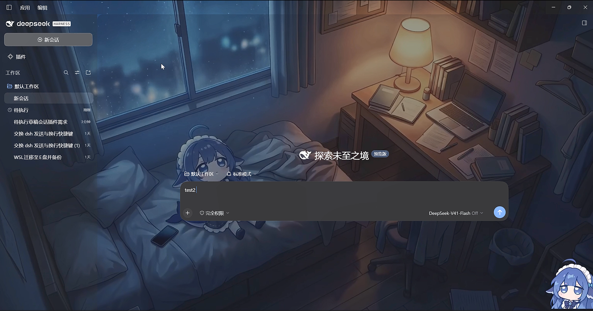

# dsh-pending-session

**把还没发送的会话草稿 保存在侧边栏**




## 核心功能

在一个会话里输入了内容但还没发送时 进入其他会话或开启新会话，原新会话不再被隐藏 而是作为一个条目留在侧边栏 与其他对话记录并列，显示名称为「待执行」。  

进入待执行点击发送即转变为正常会话  
待执行草稿删除至只剩空格再离开会被回收

待执行可同时存在多个  
待执行与正常会话之间、每个待执行之间互不影响

所有会话之间按照时间排序：

- 待执行按创建的时间
- 正常会话按最近一次向 dsh 发送对话的时间
- 编辑草稿不改变待执行的位置

待执行保存在本地，重启 dsh 不受影响。

## 待执行能怎么交互

可以随时：

- **编辑**
- **重命名**
- **归档**
- **删除**（会话下拉栏处；批量删除/归档管理不在本插件范围内）
- **发送**

## 安装 / 卸载

**安装**（任选一种）：

```sh
# 1) 在 dsh 的插件管理器里（设置 → 插件）按名字安装
dsh-pending-session
```

```sh
# 2) 在 profile 目录下用包管理器装
pnpm add dsh-pending-session
```

> [!IMPORTANT]
> 装完请**重启一次 dsh** —— 插件的宿主半边在启动时加载，不重启的话删除功能不生效。

**卸载**：

```sh
# 在插件管理器里禁用 / 移除，或者：
pnpm remove dsh-pending-session
```

已有对话、归档记录都不受影响，侧边栏恢复成原生样子。

> [!NOTE]
> 卸载**不会**清掉插件留在浏览器里的本地数据，重装后会被重新捡回。想彻底清干净就手动删掉这些键：
>
> - `dsh.pending-session.registry.v1`、`dsh.pending-session.names.v1` —— 待执行条目与名称/时间账本
> - `dsh.pending-session.active.v1` —— 退出时活动新会话的草稿文本；`dsh.conversation.<会话id>` —— 被我们改写过 `draft` 的原生草稿键
> - `dsh.pending-session.journal.v1` —— 取证日志；`dsh.pending-session.owner.v1`、`dsh.pending-session.build` —— 所有权令牌与版本探针
> - IndexedDB 数据库 `dsh-pending-session`（存储 `attachments`）—— 附件字节

## 安全与数据

> [!CAUTION]
> ### ⚠️ 删除 = 真删除，**不可恢复**
> 这个插件会在**每条会话行（包括非待执行会话）**的「…」菜单里加一项「删除会话」。
> 它会清掉**会话日志、投影缓存、工作区记账** —— 不是归档，找不回来。

- 🚫 **正在运行的会话（agent 还在输出）不允许删除**
- 📦 **归档 ≠ 删除**：归档只是从侧边栏收起，在「归档会话」里还能找回来
- 🧹 草稿清空到只剩空白后离开，条目会被自动收走（仅归档，不删数据）
- 🛡️ 删除由插件自带的宿主端点完成；**该端点不可用（例如装了插件但没重启 dsh）时只做系统原生归档、不会真删**，确认框会明确写成「已按归档处理」而不是「删除成功」，重启 dsh 后可以再删一次
- 🗄️ 插件**不处理** DSH 的 sqlite 持久化检索索引（session-query 的派生读模型，实测 schema 为 `application_id=1146308689` / `user_version=8`，表 `persisted_sessions` + fts5 `persisted_docs`）：它由会话日志重建，日志删掉后 DSH 自己会收敛。若将来 DSH 把它变成权威存储，删除路径必须另行清理
- 📎 **单个附件超过 64MB 不写进本地缓存**：条目照常建立，横幅会提示「有 N 个附件过大未保存」，重新打开条目时只恢复其余附件

## 开发

```
client.js          浏览器半边（界面、草稿镜像、侧边栏投影、删除流程）
index.js           宿主半边（删除端点：会话目录 + 投影缓存 + 工作区记账）
cordis.patch.yml   bundle 行声明
tests/sim.mjs      模拟测试
```

跑测试：

```sh
npm test        # 等价于 node tests/sim.mjs
```

本地开发：浏览器半边（client.js）拷进 profile 的 node_modules 后会热更新；
宿主半边（index.js）改动必须重启 dsh 才生效。

## License

MIT © 2026 nvjaasouid


code by: V41-Flash  
token by: 我自己(
